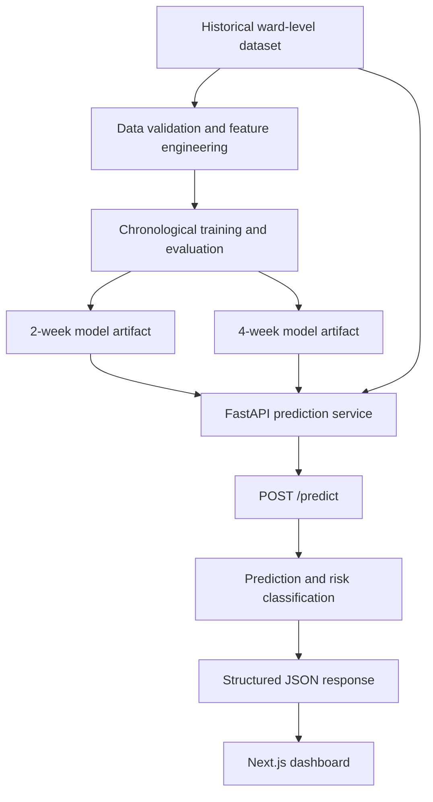

# DengueShield AI
## Technical Architecture

## 1. System overview

DengueShield AI is a three-layer research prototype:

1. **Machine-learning layer:** validates historical ward-level observations, creates forecasting features, trains separate 2-week and 4-week models, and exports model artifacts.
2. **Backend layer:** loads the dataset and model artifacts, validates prediction requests, performs inference, classifies risk, and returns structured API responses.
3. **Frontend layer:** provides the dashboard interface for selecting a location and forecast horizon and presenting the returned forecast.

## 2. High-level architecture



## 3. Data and feature engineering

The dataset covers five cities and sixty wards, with weekly observations from 4 January 2016 through 29 December 2025. The reported dataset validation contains 31,320 records, zero missing values, and zero duplicate ward-date records.

The prediction service uses historical and engineered inputs, including:

- Average temperature.
- Rainfall and accumulated rainfall windows.
- Relative humidity.
- Waterlogging risk index.
- Population density.
- Sanitation score.
- Recent dengue activity and rolling case history.
- Ward and city identifiers.

The feature-generation implementation in `ml/features.py` is the authoritative definition of the feature columns and temporal transformations. Keep the training and inference feature definitions aligned.

## 4. Model training and artifacts

Two forecast horizons are supported:

| Horizon | Artifact |
|---|---|
| 2 weeks | `models/dengue_2week.joblib` |
| 4 weeks | `models/dengue_4week.joblib` |

The model artifacts are loaded by the backend prediction service using Joblib. Each artifact contains the fitted model, its metrics, and its `risk_thresholds` configuration.

The repository also includes:

```text
models/training_metrics.json
```

This file records the dataset and model evaluation metadata. Consult the artifact for exact metrics rather than copying potentially stale values into code or documentation.

## 5. Risk classification

The backend reads the risk thresholds from the selected model artifact and applies the following inclusive upper-bound rules:

| Risk level | Rule |
|---|---|
| LOW | `prediction <= low_max` |
| MEDIUM | `low_max < prediction <= medium_max` |
| HIGH | `medium_max < prediction <= high_max` |
| CRITICAL | `prediction > high_max` |

The current artifact values are:

```json
{
  "low_max": 5.0,
  "medium_max": 9.0,
  "high_max": 14.0
}
```

This means predictions above 14 are classified as `CRITICAL`. The threshold values should remain in the model artifacts so that the backend does not maintain a conflicting hard-coded copy.

## 6. Backend request lifecycle

The backend prediction service follows this sequence:

1. Load the historical dataset and the two model artifacts when the predictor is initialized.
2. Validate that the requested ward belongs to the selected city.
3. Build the feature row for the requested ward and reference date.
4. Select the model artifact matching `horizon_weeks`.
5. Run the model prediction and prevent a negative displayed case estimate.
6. Read `risk_thresholds` from the selected artifact.
7. Assign `LOW`, `MEDIUM`, `HIGH`, or `CRITICAL`.
8. Return the forecast date, predicted cases, risk level, thresholds, weather inputs, risk drivers, and model name.

The FastAPI application exposes the live request and response schemas through Swagger at `/docs`. Swagger is the authoritative reference for endpoint fields.

## 7. Frontend integration

The Next.js application provides the user interface. It collects the city, ward, reference date, forecast horizon, and any supported weather override inputs.

The frontend sends the request to the FastAPI backend and renders the response. Prediction logic and risk classification remain in the backend; the frontend should display the returned values rather than independently recalculating the risk category.

The frontend API base URL should be configured through the environment variable referenced by the actual frontend source code. Keep local environment files out of version control.

## 8. Local deployment topology

```text
Browser
  |
  | HTTP
  v
Next.js frontend
  |
  | HTTP JSON request
  v
FastAPI backend
  |
  +--> Historical dataset
  |
  +--> 2-week Joblib artifact
  |
  +--> 4-week Joblib artifact
  |
  +--> Training metrics JSON
```

Typical local development addresses:

- Frontend: `http://localhost:3000`
- Backend: `http://127.0.0.1:8000`
- Swagger: `http://127.0.0.1:8000/docs`

The actual frontend port may change if the default port is occupied.

## 9. Performance, resource, and cost considerations

- **Local inference:** prediction is performed by the backend using locally loaded Joblib artifacts.
- **No LLM in the prediction path:** the current prediction service does not require an LLM call to produce a forecast.
- **Artifact reuse:** the predictor is initialized once per backend process and reused for subsequent requests.
- **Separate horizons:** the service selects the relevant model artifact based on the requested forecast horizon.
- **No assumed live data feed:** do not describe the system as using live weather or live case data unless those integrations are implemented and verified.
- **Build resources:** the frontend production build can require substantially more memory than type checking or running the development server. The recorded out-of-memory failure occurred on a machine with approximately 3.7 GB RAM.

## 10. Validation and evidence

The following checks should be retained as project evidence:

- Both model artifacts load successfully.
- The backend reads `risk_thresholds` from both artifacts.
- `POST /predict` returns HTTP 200 for the 2-week horizon.
- `POST /predict` returns HTTP 200 for the 4-week horizon.
- Both responses include the expected horizon, prediction, risk category, thresholds, and model name.
- A boundary/unit test confirms that `0.002096` is classified as `LOW`.
- Frontend `npm run typecheck` completes successfully.
- The dashboard can retrieve data and display a forecast when both servers are running.

Do not mark a check as passed unless its output or screenshot has been captured.

## 11. Known limitations

- The dataset ends on 29 December 2025; forecasts are not live 2026 surveillance.
- The prototype does not establish causal relationships between risk-driver indicators and dengue incidence.
- Forecast outputs are estimates and require validation against verified current data before operational use.
- The application is a research prototype and is not a diagnostic system.
